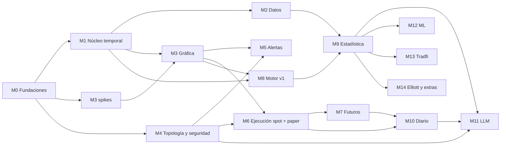

# Roadmap

Fuente de verdad del trabajo: los **issues de GitHub**. Este archivo es el mapa.

> **Milestones**: desde la sesión de planificación no se podían crear Milestones de
> GitHub. Cada milestone es un **issue épico** (etiqueta `epic`), sus issues son
> **sub-issues** y llevan la etiqueta del milestone (`M0`…`M14`). Si se crean Milestones
> reales, basta con asignar cada issue al milestone de su etiqueta.

Etiquetas: `M0`…`M14` (milestone), `area:*` (componente), `tipo:spike` (investigación
con decisión documentada), `necesita-refinamiento` (no empezar sin refinar con datos o
con una decisión del usuario).

Cada issue tiene **Contexto, Objetivo, Alcance, Dependencias ("Bloqueado por") y
Criterios de aceptación verificables**. Guía para agentes: [AGENTES.md](AGENTES.md).

---

## Dependencias entre milestones

## Prototipo inicial (P0) · seguimiento #141

Lo primero que se construye: grabador de Binance BTC/ETH + gráfica local con máquina del
tiempo, en la PC. Qué incluye, qué demuestra y qué no: [PROTOTIPO.md](PROTOTIPO.md).
Después, **P1 — grabador en producción**: #33, #42, #43, #139, #34–#37 y el gate #140.

## Por dónde empezar (sin dependencias pendientes)

1. **#2** M0-01 Monorepo y CI.
2. En cuanto #2 esté cerrado, en paralelo: **#17** (IDL), **#20** (tests de arquitectura),
   **#44** (spike de Lightweight Charts), **#45** (spike de Tauri Android + push),
   **#106** (registro de hipótesis).
3. **Camino crítico al grabador** (cada día grabado es historia perfecta):
   #2 → #17 → #18 → #19 → #22 + #23 → #24 → **#32** (grabador de Binance).

---

## M0 — Fundaciones · épico #1

| ID | Issue | Bloqueado por |
|---|---|---|
| M0-01 | #2 Monorepo y CI base | — |
| M0-02 | #17 IDL: identidad, instrumentos, tiempo, sobre, eventos de mercado | #2 |
| M0-03 | #18 IDL: trading | #17 |
| M0-04 | #19 bender-types y generación de tipos | #17, #18 |
| M0-05 | #20 Tests de arquitectura y lints de pilares | #2 |
| M0-06 | #21 Transporte en proceso/red con streams reanudables | #19 |

## M1 — Núcleo temporal · épico #3

| ID | Issue | Bloqueado por |
|---|---|---|
| M1-01 | #22 bender-store | #19 |
| M1-02 | #23 Orden total y fusión de fuentes | #19 |
| M1-03 | #24 Reloj por eventos, latidos y huecos | #23, #20 |
| M1-04 | #25 Velas 1s–1Y, marca de agua, tardíos | #24 |
| M1-05 | #26 Velas compuestas multi-venue | #25 |
| M1-06 | #27 Eventos de usuario y estado `as_of` | #24 |
| M1-07 | #28 Checkpoints y manifiestos | #22, #25, #27 |
| M1-08 | #29 Runner (live/replay/backtest/dataset) | #28 |
| M1-09 | #30 Tests normativos y test dorado | #29, #26 |
| M1-10 | #31 Bindings Python | #29 |

## M2 — Datos · épico #4

| ID | Issue | Bloqueado por |
|---|---|---|
| M2-01 | #32 Grabador Binance | #22, #24 |
| M2-02 | #33 Specs de instrumentos versionadas | #32 |
| M2-03 | #34 Grabador Bybit | #32, #33 |
| M2-04 | #35 Grabador BloFin | #32, #33 |
| M2-05 | #36 Grabador BingX | #32, #33 |
| M2-06 | #37 Grabador MEXC | #32, #33 |
| M2-07 | #38 Re-normalización versionada | #32 |
| M2-08 | #39 Backfill Binance | #22, #24 |
| M2-09 | #40 Backfill Bitstamp + Coinbase | #39 |
| M2-10 | #41 Backfill Bybit | #39 |
| M2-11 | #42 Calidad de datos | #32, #39 |
| M2-12 | #43 Operación del grabador y retención (ADR-0009) | #32 |
| M2-13 | #138 Spike: inventario de tradfi gratuito | #33 |
| M2-14 | #139 Archivado comprimido de datos irreemplazables | #22, #43 |
| M2-15 | #140 Gate de producción y migración a la mini-PC | #32, #42, #43, #139 |

## M3 — Gráfica · épico #5

| ID | Issue | Bloqueado por |
|---|---|---|
| M3-01 | #44 Spike Lightweight Charts (ADR-0001) | #2 |
| M3-02 | #45 Spike Tauri Android + push (→ ADR-0008) | #2 |
| M3-03 | #46 bender-query: velas `as_of` | #29, #26, #21 |
| M3-04 | #47 chart-scene | #19, #44 |
| M3-05 | #48 render-lwc base | #44, #47, #46 |
| M3-06 | #49 Herramientas de dibujo e interacción | #48 |
| M3-07 | #50 Perfiles de volumen y VWAP en el motor | #46, #26 |
| M3-08 | #51 Render de perfiles + herramienta | #50, #49 |
| M3-09 | #52 Indicadores en el motor + render | #46, #48 |
| M3-10 | #53 Universo curado | #46, #33 |
| M3-11 | #54 Máquina del tiempo y replay en la UI | #48, #47, #29 |
| M3-12 | #55 Shell escritorio + Android | #45, #48 |

## M4 — Topología y seguridad · épico #6

| ID | Issue | Bloqueado por |
|---|---|---|
| M4-01 | #56 bender-api con alcances | #21 |
| M4-02 | #57 Emparejamiento y firma de comandos | #56 |
| M4-03 | #58 Firma en Android Keystore con biometría | #57, #55 |
| M4-04 | #59 Perfiles de despliegue, usuarios, ACL, firewall | #21 |
| M4-05 | #60 Leases y cola de trabajos | #21 |
| M4-06 | #61 Sincronización de segmentos por hash | #22, #21 |
| M4-07 | #62 Infra doméstica (UPS, watchdog, IP fija) | #59 |

## M5 — Alertas · épico #7

| ID | Issue | Bloqueado por |
|---|---|---|
| M5-01 | #63 Evaluador de alertas en el Runner | #29, #52, #27 |
| M5-02 | #64 bender-notify | #45, #56 |
| M5-03 | #65 UI de alertas | #63, #64, #49 |

## M6 — Ejecución spot + paper · épico #8

| ID | Issue | Bloqueado por |
|---|---|---|
| M6-01 | #66 Contrato Venue, capacidades, suite de conformidad | #18, #19 |
| M6-02 | #67 Simulador de exchange con fallas | #66, #29 |
| M6-03 | #68 bender-execution esqueleto | #66, #60, #57, #59 |
| M6-04 | #69 Estados de orden, UNKNOWN, idempotencia | #68, #67 |
| M6-05 | #70 Limitador de tasa con reserva | #68 |
| M6-06 | #71 Paper spot | #66, #29 |
| M6-07 | #72 Binance spot privado | #69, #70, #33 |
| M6-08 | #73 Reconciliación | #69, #67 |
| M6-09 | #74 Triggers de servidor | #69, #25 |
| M6-10 | #75 Order lines y escaleras | #49, #57, #69, #71 |
| M6-11 | #76 Planes de acumulación | #75 |
| M6-12 | #77 Botón rojo | #69, #57 |

## M7 — Futuros · épico #9

| ID | Issue | Bloqueado por |
|---|---|---|
| M7-01 | #78 Spike capacidades Binance USDⓈ-M | #66 |
| M7-02 | #79 Spike Bybit | #66 |
| M7-03 | #80 Spike BloFin | #66 |
| M7-04 | #81 Spike BingX | #66 |
| M7-05 | #82 Spike MEXC (¿API habilitada?) | #66 |
| M7-06 | #83 Saga de trade con P0/P1/P2 | #69, #67 |
| M7-07 | #84 Monitor de invariantes y escalera de exposición | #83 |
| M7-08 | #85 Reconciliación de futuros y adopción | #83, #73 |
| M7-09 | #86 Suite de propiedades y caos | #84, #85 |
| M7-10 | #87 Paper de futuros | #71, #83 |
| M7-11 | #88 Guardarraíles | #83 |
| M7-12 | #89 Binance USDⓈ-M privado + runbook | #78, #86, #72 |
| M7-13 | #90 Ticket de futuros | #83, #49, #57 |
| M7-14 | #91 Alertas de estado de cuenta | #64, #83 |
| M7-15 | #92 BloFin privado | #80, #86 |
| M7-16 | #93 BingX privado | #81, #86 |
| M7-17 | #94 Bybit privado | #79, #86 |
| M7-18 | #95 MEXC privado (condicionado) | #82, #86 |

## M8 — Motor de mercado v1 · épico #10

| ID | Issue | Bloqueado por |
|---|---|---|
| M8-01 | #96 Features L1 | #29, #26 |
| M8-02 | #97 Registro de niveles con procedencia | #96 |
| M8-03 | #98 Detector de canales (`necesita-refinamiento`: definiciones con el usuario) | #97, #50 |
| M8-04 | #99 Herramienta "marcar inicio de canal" | #98, #54 |
| M8-05 | #100 S/R, sesiones, POC vírgenes, redondos, Fibo, niveles propios | #97, #50 |
| M8-06 | #101 Eventos L3 versionados | #97 |
| M8-07 | #102 Confluencias L4 | #101, #100 |
| M8-08 | #103 Overlays y panel de procedencia | #101, #48 |
| M8-09 | #104 Alertas por evento del motor | #101, #63 |

## M9 — Estadística auditable · épico #11

| ID | Issue | Bloqueado por |
|---|---|---|
| M9-01 | #105 Etiquetador de tres resultados | #101, #29 |
| M9-02 | #106 Registro de hipótesis | #2 |
| M9-03 | #107 Dataset histórico de eventos | #105, #40, #31 |
| M9-04 | #108 Modelos base B0–B4 | #107 |
| M9-05 | #109 Walk-forward, caja fuerte, N efectivo | #107 |
| M9-06 | #110 Métricas de calibración y discriminación | #109 |
| M9-07 | #111 Tablas beta-binomial jerárquicas | #109, #108 |
| M9-08 | #112 Objeto Estimate y promoción | #110, #111, #106 |
| M9-09 | #113 Panel de auditoría | #112, #54 |
| M9-10 | #114 Calibración en vivo | #112 |
| M9-11 | #115 Narrador por plantillas | #112, #101 |

## M10 — Diario · épico #12

| ID | Issue | Bloqueado por |
|---|---|---|
| M10-01 | #116 Registro automático desde el ledger | #68 |
| M10-02 | #117 Campos del usuario | #116 |
| M10-03 | #118 Flags automáticos | #116, #88 |
| M10-04 | #119 Estadísticas | #116 |
| M10-05 | #120 UI del diario | #117, #119, #54 |

## M11 — LLM · épico #13

| ID | Issue | Bloqueado por |
|---|---|---|
| M11-01 | #121 llm-gateway con herramientas de consulta | #119, #56, #112 |
| M11-02 | #122 assistant_notes | #116, #56 |
| M11-03 | #123 Seis pruebas de aislamiento en CI | #121, #122, #59, #20 |
| M11-04 | #124 Runtime en la estación + chat | #121 |
| M11-05 | #125 Runtime Android aislado | #121, #55, #58 |
| M11-06 | #126 Set de evaluación | #121 |
| M11-07 | #127 QLoRA del 4B y despliegue | #126, #124 |

## M12 — ML · épico #14 (`necesita-refinamiento`)

| ID | Issue | Bloqueado por |
|---|---|---|
| M12-01 | #128 Modelos calibrados por tipo de evento | #112 |
| M12-02 | #129 Detector de inicio de canal aprendido | #99, #109 |
| M12-03 | #130 Pesos de confluencia aprendidos | #128, #102 |

## M13 — Mercado tradicional · épico #15

| ID | Issue | Bloqueado por |
|---|---|---|
| M13-01 | #131 Sesiones y calendarios en el núcleo | #25 |
| M13-02 | #132 Diarios gratuitos y continuos con roll | #22, #131 |
| M13-03 | #133 Compra de intradía (decisión del usuario) | #132 |
| M13-04 | #134 Estudio y modelos tradfi | #133, #112 |

## M14 — Elliott y extras · épico #16 (`necesita-refinamiento`)

| ID | Issue | Bloqueado por |
|---|---|---|
| M14-01 | #135 Elliott | #97, #112 |
| M14-02 | #136 DSL de indicadores | #52, #63 |
| M14-03 | #137 Footprint y heatmap | #48, #32 |
